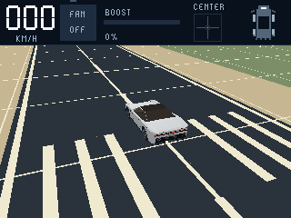
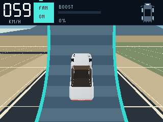
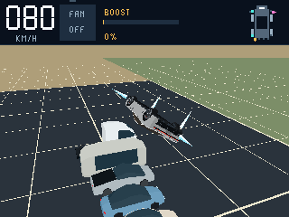

# Roadster Badge

A continuous 3D driving and stunt playground for the **GitHub Universe 2026
Badger 2350**. Drive a handmade Roadster, fire individual thrusters, stick to the
open ramp with the fan, and jump over a lineup of ten parked Teslas.

| Airfield | Open Ramp | Tesla Lineup |
| --- | --- | --- |
|  |  |  |

*Actual native preview frames. Badge performance is measured separately.*

The scenes use dark pavement, broad ivory markings, warm ground and a stable
mountain horizon. Fixed ground seams and distant survey lines make movement
visible while driving and flying.

Tilt the badge to look around while driving on the ground, or rotate in the air.
Return to center to restore the view or ask the airborne jets to level the car.
A deliberate flick attempts a complete kickflip, backflip or frontflip. Impacts
stay physical; there is no failure screen or automatic reset.

**This repository is the complete project.** The game, procedural models,
installer, packaging tools, tests and optional browser preview live here. It
does not need another local checkout. The badge must already have compatible
Universe firmware with `badgeware` and native `pico3d`.

## Put it on your badge

Download or clone this repository, open a terminal in its folder, and run:

```sh
python3 -m venv .venv
source .venv/bin/activate
python3 -m pip install -r requirements.txt
python3 tools/install_badge.py plan
python3 tools/install_badge.py list
python3 tools/install_badge.py install --port YOUR_PORT
```

Replace `YOUR_PORT` with the GitHub badge's port from `list`. On Windows use
`py -3` and `.venv\Scripts\activate`. The installer backs up the previous
Roadster app, verifies the uploaded files, and returns to the existing menu.
Choose **Roadster Sandbox** (or `roadster_sandbox`). This installs an app, not
firmware; copying the ZIP onto a UF2 boot drive will not install it.

See [installation and recovery](docs/INSTALL.md) for packaged releases,
immediate launch, supported firmware and restoring an app backup. No browser
build or external deployment utility is required.

## Play

Hold the badge in the inverted gamepad grip, facing you. Tap the outer right
touch pad and hold still to center it. Release the thrust controls afterward.

| Control | Action |
| --- | --- |
| Touch D-pad | Drive, brake/reverse and steer |
| Outer right touch pad | Rear boost |
| Inner right touch pad | Lift |
| Tilt | Ground camera / air rotation |
| Deliberate flick | Complete flip attempt |
| Clicky directions | Controlled pitch and roll |
| Clicky center | Fan on/off |
| Left middle touch pad | Options; Reset car is first |
| Right middle touch pad | Scene chooser |

Airfield is open practice space. Open Ramp starts with a centered rear camera.
Tesla Lineup puts the parked cars side by side to jump over, with the same
follow camera as Airfield. Only the new Roadster is drivable. The fan and jets
can operate together; strong suction can hold the car down.

The top instruments show km/h, delivered boost, fan state, tilt and active
jets. After calibration, LOOK means grounded tilt controls the camera; holding
lift or boost keeps tilt assigned to the jets. Unlimited air is the practice
default. Lift launches strongly and eases
toward a hover instead of climbing indefinitely. See the [complete controls
guide](docs/CONTROLS.md) for motion modes, calibration and laptop shortcuts.

## Build, test and reuse

Python 3.9+ is enough for the host tests, packaging and mesh export:

```sh
python3 tools/test.py
python3 tools/check_repo.py
python3 tools/package_app.py roadster_sandbox
python3 tools/export_models.py
python3 tools/package_repo.py
```

Outputs go to `dist/`: the installable app ZIP, editable OBJ/MTL models, and a
source ZIP with checksums. These commands never open a serial port. The eleven
vehicle meshes are generated from Python; there are no downloaded model or
texture assets. Their shapes are visual approximations, not manufacturer CAD.

The optional [browser preview](playground/README.md) runs actual MicroPython and
native pico3d in WASM. Its first setup downloads pinned platform sources and
requires a compiler toolchain. Host tests, app packaging, model export and badge
installation do not require that toolchain.

## Find your way around

| Path | Purpose |
| --- | --- |
| `apps/roadster_sandbox/` | Complete deployable game and generated-in-code models |
| `tools/` | Local installer, package/export tools and host checks |
| `playground/` | Optional native browser preview and runtime tests |
| `docs/` | Controls, architecture, development, installation and validation |
| `validation/` | Portable source provenance and release evidence |
| `AGENTS.md` | Working contract for coding agents |

Start with [architecture](docs/ARCHITECTURE.md) to modify the game,
[development](docs/DEVELOPMENT.md) to verify changes, and
[validation](docs/VALIDATION.md) for measured results and remaining limits.
Contributions are covered in [CONTRIBUTING.md](CONTRIBUTING.md).

The app source, handmade models and project tools are MIT-licensed.
Vehicle geometry, force models and controls are defined in this repository.
See [LICENSE](LICENSE), [platform notices](THIRD_PARTY_NOTICES.md) and
[provenance](docs/PROVENANCE.md) for the source and runtime boundaries.
This is an independent game, not an official Tesla product; its performance
and thruster parameters are game tuning, not claims about real vehicles.
